# 🇬🇧 English guide - Adding a dé EV Charger to Home Assistant locally

**Tuya EV Charger Local + Smart Life / Tuya Smart + local_key**

🇫🇷 [Version française](guide-fr.md) · This is an English translation of the French guide written by [@tiiiit74](https://github.com/tiiiit74).

**Terminology:** this guide covers a dé portable charger, often called a **CRO** in France (« câble de recharge occasionnelle », an occasional-use charging cable). From here on, we call the device the **dé charger**.

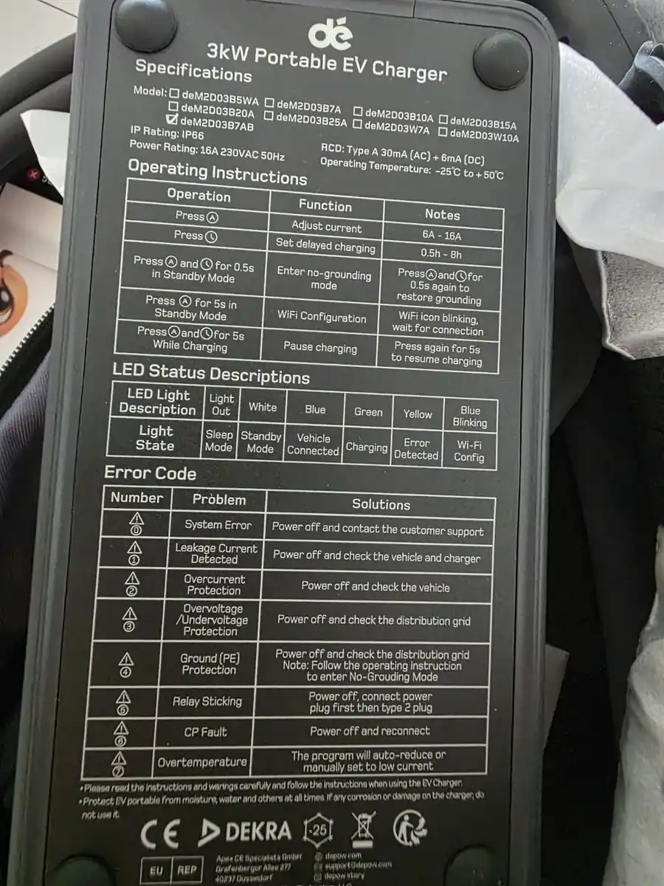

*Screenshot 01 - Label of the model actually tested: deM2D03B7AB.*

> **Scope:** this guide covers pairing, retrieving the `local_key` and the local integration of the dé charger. The Shelly Pro 3EM, dynamic load shedding and solar charging will be covered in a second guide.

# 1. Tested setup and principle

Reference setup:

- dé Portable EV Charger 3.7 kW / 16 A, model deM2D03B7AB
- 2.4 GHz Wi-Fi
- Home Assistant OS
- HACS
- Smart Life for the initial pairing on the reference installation; Tuya Smart was also used in the second community test
- Tuya protocol 3.5
- `depow_v2` profile in Tuya EV Charger Local (firmware 1.9.9 on the tested hardware)

> **Safety:** the dé charger's label mentions a "no-grounding" mode. Do not enable it to work around a missing or faulty earth. Charging a vehicle must stay on a compliant, properly protected electrical installation.

The general principle is simple:

```text
dé charger
  ↓
Smart Life or Tuya Smart
(Wi-Fi pairing)
  ↓
  ├─ Tuya Local Key (recommended method)
  │    → Device ID + local_key
  │
  └─ Tuya Cloud (advanced method)
       → automatic retrieval of the credentials
  ↓
Tuya EV Charger Local
  ↓
Home Assistant
  ↓
local LAN control
```

There are two ways to retrieve the `local_key`:

1. **Simple, recommended method: Tuya Local Key**
   - no Tuya Developer account
   - no Cloud Project
   - no Access ID / Access Secret
   - sign-in by QR code with your Smart Life / Tuya account

2. **Advanced method: Tuya Cloud**
   - needs a Tuya Developer account and a Cloud Project
   - takes longer to set up
   - lets Tuya EV Charger Local retrieve a new `local_key` automatically if it changes after a re-pairing

# 2. Pairing the dé charger in Smart Life or Tuya Smart

1. Plug the dé charger into the mains, without a vehicle if you only want to configure it.
2. Hold button **A** for about 5 seconds until the Wi-Fi icon blinks.
3. In Smart Life or Tuya Smart, add the device and connect it to your **2.4 GHz** Wi-Fi network.
4. Once pairing is done, check the device information and any available updates.

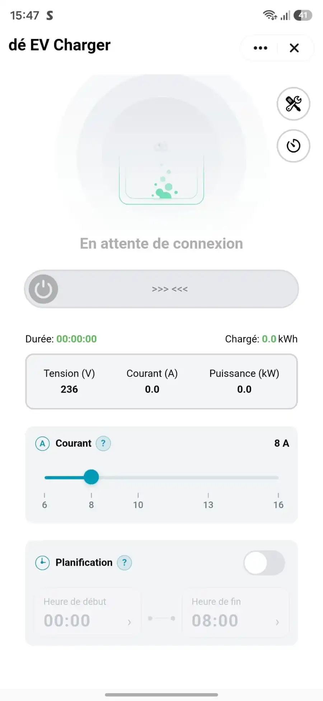

*Screenshot 02 - Main screen of the dé EV Charger in Smart Life.*


*Screenshot 03 - dé charger information in Smart Life: version, maximum current and network information.*


*Screenshot 04 - Checking the firmware update.*

> **Tip:** avoid re-pairing the dé charger needlessly once the installation works. A new pairing can change the `local_key`.

# 3. Optional: what the official Tuya integration gives you

**This step is not needed to follow the guide.** In the tested installation, Home Assistant's official Tuya integration does see the dé charger, but classifies it as an unsupported device and creates no usable entity.

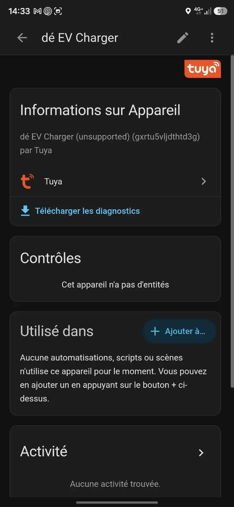

*Screenshot 05 - The dé charger appears in the official Tuya integration as "unsupported" with 0 entities.*


*Screenshot 06 - The dé EV Charger is listed among the Tuya devices in Home Assistant.*

> **This is not blocking:** the rest of the guide uses Tuya EV Charger Local, which talks to the charger directly on the local network.

# 4. Installing Tuya EV Charger Local with HACS

On a **new installation**, first add Valentin's repository as a HACS custom repository:

1. Open **HACS → Integrations**.
2. Open the top-right menu, then **Custom repositories**.
3. Add:

```text
https://github.com/lachand/EV_charger
```

4. Choose the **Integration** category.
5. Then search for **Tuya EV Charger Local** in HACS and install it.
6. Restart Home Assistant if HACS asks you to.

> If **Tuya EV Charger Local** already appears in your HACS, do not add anything: the repository is already known to your installation. Just install the integration.

# 5. Recommended method: retrieving the local_key with Tuya Local Key

This is the simplest method for a new installation.

Project used:

https://github.com/vineetchoudhary/tuya-local-key

Its documentation states explicitly that it needs **no Tuya Developer account, no Cloud Project, no Access ID and no Access Secret**.

## 5.1 Installing Tuya Local Key in Home Assistant

For Home Assistant OS:

1. Open **Settings → Apps → App Store**.
2. Open the top-right menu.
3. Choose **Repositories**.
4. Add:

```text
https://github.com/vineetchoudhary/tuya-local-key
```

5. Install **Tuya Local Key** from the App Store.
6. Open the app from Home Assistant.


*Screenshot 07 - Installation instructions for Tuya Local Key in Home Assistant.*

The app uses Home Assistant Ingress by default. There is no need to expose its port directly to the Internet.

## 5.2 Signing in to your Smart Life or Tuya Smart account

The sign-in flow uses a QR code.

With **Smart Life**:

1. note your **User Code** in **Me → Settings → Account and Security → User Code**
2. enter this code in Tuya Local Key
3. the tool displays a QR code
4. scan it with Smart Life
5. confirm the connection in the app

Tuya Local Key's default QR scheme is `smartlife`.

If you use **Tuya Smart**, open the Tuya Local Key app configuration and choose the `tuyaSmart` QR scheme if needed.

After signing in, the list of the account's devices appears. **Tuya Local Key directly retrieves the charger's Device ID and `local_key`.**

## 5.3 Copying the dé charger's local_key

In the device list:

1. find **dé EV Charger**
2. check that it is shown as **online**
3. note its **Device ID**
4. copy its **Local Key**

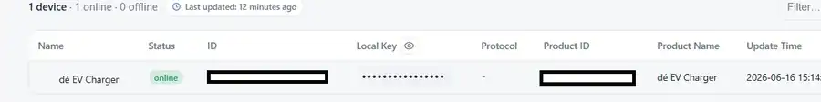

*Screenshot 08 - The dé charger in Tuya Local Key with its status, Device ID, Local Key and Product ID. Sensitive identifiers are masked.*

The Device ID is useful to check that you then select the right device, but you do not need to copy it manually if the Tuya EV Charger Local scan works.

> **Secret:** never publish your `local_key`. Tuya Local Key may cache the device list in Home Assistant, so treat backups of this app as sensitive data too.

# 6. Adding the dé charger in Tuya EV Charger Local

In **Settings → Devices & services → Add integration**, search for **Tuya EV Charger Local**.

Choose **Scan network**.

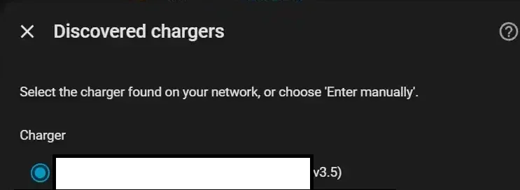

*Screenshot 09 - The network scan discovers the Tuya devices on the local network.*

The Tuya EV Charger Local scan listens to Tuya announcements and pre-fills:

- the local IP address
- the Device ID
- the Tuya protocol version

> **Network:** this scan needs Home Assistant to be on the **same subnet** as the dé charger. Tuya UDP broadcasts do not cross VLANs or most Wi-Fi repeaters working in NAT mode.

Select the dé charger matching the Device ID you noted in Tuya Local Key.

In **Charger credentials**:

1. check the IP and the Device ID
2. paste the `local_key`
3. on the tested model, use:
   - **Protocol version: 3.5**
   - **Charger profile / DP mapping: depow_v2**
4. confirm

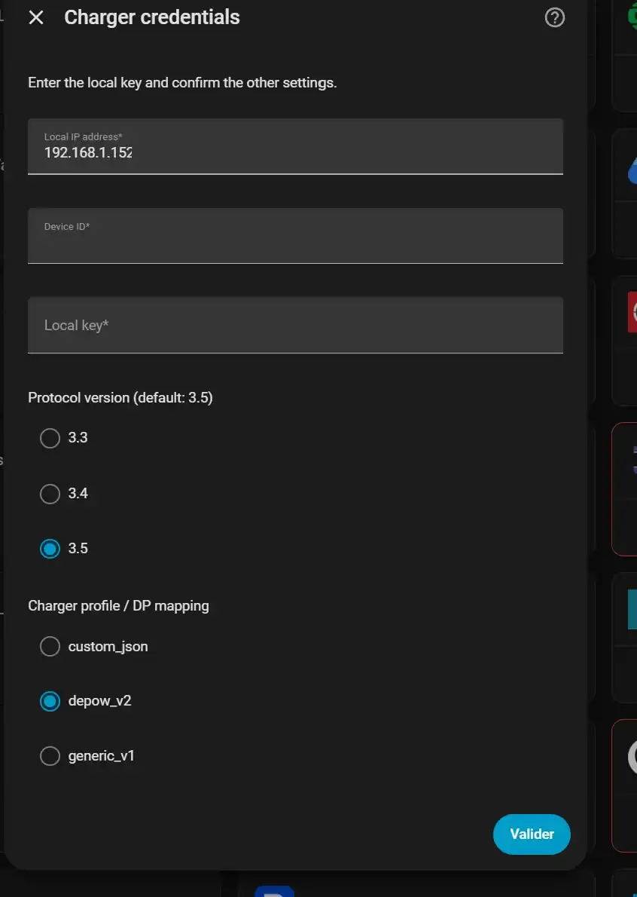

*Screenshot 10 - The "Charger credentials" screen. In this screenshot the local_key had not been entered yet; the IP and Device ID are masked.*

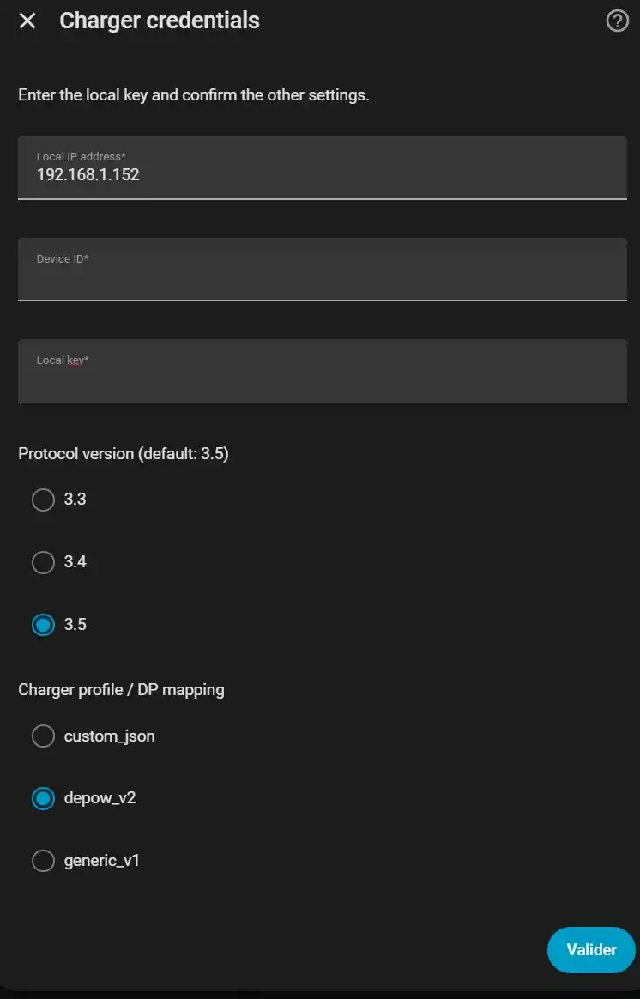

*Screenshot 11 - Settings confirmed on the tested model: protocol 3.5 and depow_v2 profile.*

```text
Protocol version: 3.5
Charger profile / DP mapping: depow_v2
```

> **Choosing the profile according to the firmware:** `depow_v2` matches the charger tested here (firmware 1.9.9). The dé 3.5/3.7 kW models of Tuya category `qccdz` with firmware 1.1.25 or later use `qccdz_v1`, added by [PR #62](https://github.com/lachand/EV_charger/pull/62) (which replaces PR #58). If the status stays `unknown` and every measurement is 0, check the profile selected in the integration options. That symptom alone is not enough to diagnose a profile problem.

### If the network scan does not find the dé charger

You can choose **Enter everything manually** in Tuya EV Charger Local if you already know the IP, the Device ID, the `local_key` and the protocol.

Tuya Local Key also has its own **Scan network** button: it can look for the local IP and the protocol version on a subnet you specify manually, including across a VLAN if the firewall allows TCP 6668 from Home Assistant.

# 7. Checking the integration in Home Assistant

Once the integration is confirmed, Home Assistant creates the device and exposes the available controls, sensors and options.

Without a vehicle, some measurements naturally stay at zero or unknown.


*Screenshot 12 - Example of the Configuration and Diagnostic sections after the integration is set up.*

Important entities:

- **Current setpoint**: current setpoint
- **Voltage / Current / Power L1**: electrical measurements
- **Temperature**: temperature reported by the dé charger
- **Status**: charger state
- **Connection health**: health of the local communication
- **Session energy**: energy of the session
- **Solar surplus mode**: left disabled in this first tutorial

# 8. First test without a vehicle: 6 A → 7 A

The current setting can be tested without a vehicle.

On the unit used for this guide, the values **6, 7, 8, 9 and 12 A** were written and read back correctly.

This confirms that the dé charger accepts 1 A steps, even though Smart Life only offers a few preset values.


*Screenshot 13 - Home Assistant history showing the change from 6 A to 7 A and the new setpoint read back.*

> **Test result:** the command makes the dé charger beep immediately, then Home Assistant reads back the new setpoint a few seconds later.

# 9. Power-cut test

An additional test was done with the setpoint left at **8 A**:

1. unplug the dé charger for about 30 seconds
2. plug it back in
3. wait for it to reconnect

After the restart, the **8 A** setpoint was still there.

> **Consequence:** keeping the setpoint is convenient, but it will have to be taken into account later in any load-shedding or fail-safe logic.

After a power cut, the status can also stay `unknown` for a while before becoming consistent again.

# 10. Alternative advanced method: retrieval through Tuya Cloud

The Cloud method remains available if you prefer **Tuya EV Charger Local** to retrieve the Device ID and the `local_key` directly.

It takes longer to set up, but has one advantage: the Cloud credentials let the integration retrieve a new `local_key` automatically after the dé charger is re-paired.

> **Good to know:** the integration's current README states that Tuya IoT trial projects expire after about **1 month** and can be extended up to about **6 months**. After expiry, Cloud retrieval stops working, but local control of the dé charger carries on.

## 10.1 Choosing Fetch credentials from Tuya Cloud

When adding Tuya EV Charger Local, choose **Fetch credentials from Tuya Cloud**.


*Screenshot 14 - The Tuya Cloud credentials screen. The Access Secret must never be published.*

## 10.2 Creating a Tuya Developer account

1. Go to https://iot.tuya.com
2. create or activate a developer account
3. check that your account is registered as an **Individual Developer**

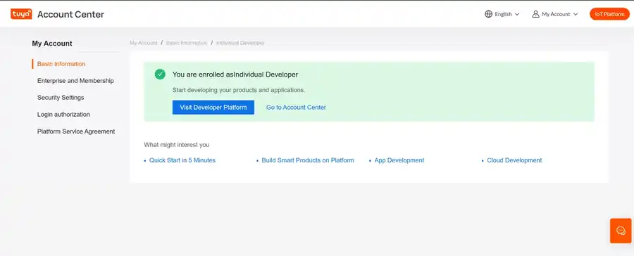

*Screenshot 15 - Tuya account registered as an Individual Developer.*

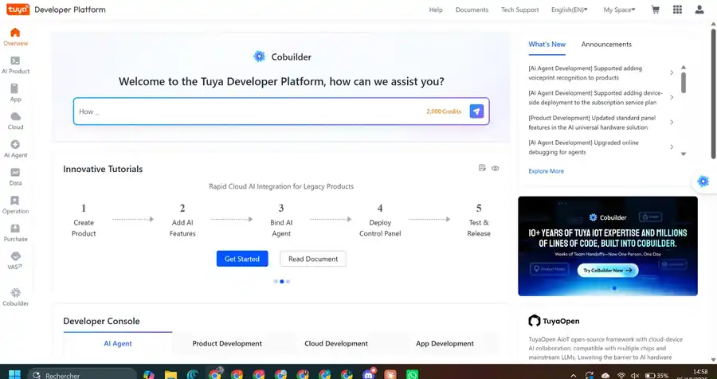

*Screenshot 16 - Home page of the Tuya Developer Platform.*

## 10.3 Creating the Cloud Project

1. open **Cloud → Project Management**
2. create a project, for example **Home Assistant EV Charger**
3. choose **Smart Home**
4. select the Data Center matching your account

For the European installation tested: **Central Europe Data Center**.


*Screenshot 17 - Creating the Cloud Project.*

### Authorizing the APIs

In the wizard, authorize the services needed for Smart Home access.

In the tested configuration, these include:

- IoT Core
- Authorization Token Management
- Smart Home Basic Service

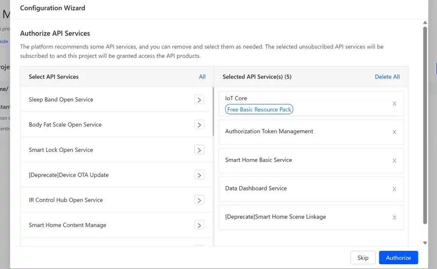

*Screenshot 18 - API services authorization wizard.*

### Retrieving the Access ID and Access Secret

In **Overview**, note:

- Access ID / Client ID
- Access Secret / Client Secret


*Screenshot 19 - Sensitive credentials are masked in the public version.*

## 10.4 Linking the Tuya app account to the project

In **Devices → Link Tuya App Account**, link the account of the app in which the dé charger is actually paired.

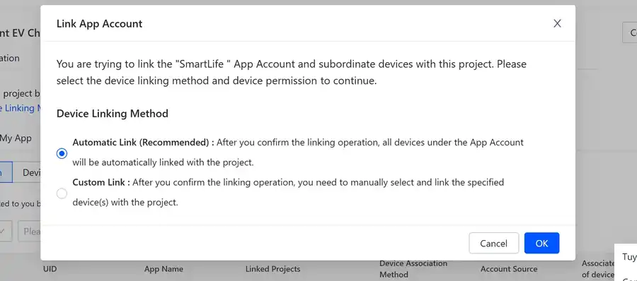

*Screenshot 20 - Account linking window.*

You can use **Custom Link** to link only the dé charger.

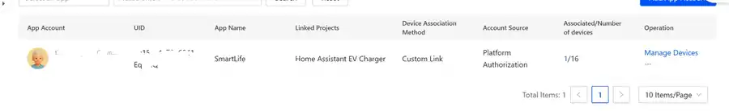

*Screenshot 21 - A single device linked to the project.*

## 10.5 Back in Home Assistant

In **Tuya EV Charger Local**:

1. choose **Fetch credentials from Tuya Cloud**
2. enter the Access ID and Access Secret
3. choose the matching region
4. select the dé EV Charger

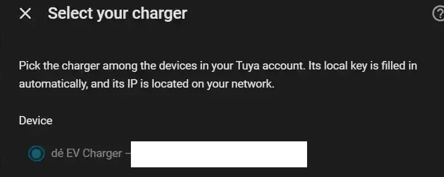

*Screenshot 22 - Selecting the dé charger among the devices returned by Tuya Cloud.*

The integration then fills in the `local_key` automatically and finds the charger on the LAN.

## 10.6 If Home Assistant says "no devices in this Tuya IoT project"

Before recreating the project or re-pairing the dé charger, check the following:

| Check | Expected result |
|---|---|
| App used | the linked account matches the app in which the dé charger is actually paired: Smart Life or Tuya Smart |
| Data Center | the Cloud Project uses the Data Center matching the account |
| App Account | the app account is really linked to the Cloud Project |
| Manage Devices | the dé EV Charger really appears in the list |
| Device Status | `Online` |
| Associated devices | the dé charger is counted among the associated devices, for example `1/1` if only the charger is linked |
| API Services | the services needed for the Smart Home project are authorized |
| Credentials | the Access ID and Access Secret really come from this same Cloud Project |

In the tested configuration, the services offered included **IoT Core**, **Authorization Token Management** and **Smart Home Basic Service**.

> **Important:** a "linked" app account does not on its own guarantee that the dé charger is really associated with the project. Always check **Manage Devices** before looking further.

If this method stays blocked, the **Tuya Local Key** method described above retrieves the Device ID and the `local_key` directly, without depending on the Cloud Project.

# 11. Network tips and troubleshooting

- Use a stable 2.4 GHz Wi-Fi at the dé charger.
- Home Assistant must be able to reach the charger on the local network.
- A DHCP reservation for the IP address is recommended.
- If the dé charger is re-paired, the `local_key` may change.
- For a setup where the key was entered manually, retrieve the new `local_key` with Tuya Local Key, then use **Configure → Reconfigure** in the Tuya EV Charger Local integration. Do not delete the integration: deleting it would lose the entities' history and the energy statistics.
- If Tuya Cloud credentials have been configured in the integration, it can retrieve a new `local_key` automatically.
- Leave the internal schedule disabled until you need it.
- Do not enable the "no-grounding" mode to work around an earth problem.
- Never publish your Access Secret, `local_key` or account credentials.
- **One local client per charger:** the charger only accepts one local connection at a time. Smart Life/Tuya Smart or another local integration may conflict with Home Assistant and cause intermittent communication failures.

# 12. What next?

This installation is the foundation.

The project can then grow towards:

- session and energy tracking
- Home Assistant notifications
- three-phase measurement with a Shelly Pro 3EM
- load shedding on the dé charger's phase
- fail-safe if the measurements are lost
- photovoltaic surplus detection
- dynamic charge regulation
- comparison of the dé charger's internal temperature with the outside temperature of the enclosure

> **Important:** these advanced functions are deliberately not configured in this guide. They will be covered in a separate tutorial to keep this procedure simple and reproducible.

# 13. Acknowledgements

Thanks to **Valentin Lachand** for the development and maintenance of **Tuya EV Charger Local**.

Repository:
https://github.com/lachand/EV_charger

Thanks also to the developer of **Tuya Local Key** for the simplified `local_key` retrieval tool.

Repository:
https://github.com/vineetchoudhary/tuya-local-key

This guide is based on an installation that was actually tested and on a second integration test carried out by a community user. As the Tuya, Smart Life, HACS and Home Assistant interfaces may change, the exact labels may differ slightly over time.
