# 🇫🇷 Guide FR - Intégrer un dé EV Charger dans Home Assistant en local

**Tuya EV Charger Local + Smart Life / Tuya Smart + local_key**


*Capture 02 - Étiquette du modèle réellement testé : deM2D03B7AB.*

Version illustrée V4 - octobre 2026

> **Périmètre :** ce guide couvre l'appairage, la récupération de la `local_key` et l'intégration locale du CRO. Le Shelly Pro 3EM, le délestage dynamique et la recharge solaire feront l'objet d'un second guide.

# 1. Configuration testée et principe

Configuration de référence :

- dé Portable EV Charger 3,7 kW / 16 A, modèle deM2D03B7AB
- Wi-Fi 2,4 GHz
- Home Assistant OS
- HACS
- Smart Life pour l'appairage initial sur l'installation de référence ; Tuya Smart également utilisé lors du second test communautaire
- protocole Tuya 3.5
- profil `depow_v2` dans Tuya EV Charger Local

> **Sécurité :** l'étiquette du CRO prévoit un mode « no-grounding ». Ne l'activez pas pour contourner une absence ou un défaut de terre. La recharge d'un véhicule doit rester sur une installation électrique conforme et correctement protégée.

Le principe général est simple :

```text
CRO dé
  ↓
Smart Life ou Tuya Smart
(appairage Wi-Fi)
  ↓
  ├─ Tuya Local Key (méthode recommandée)
  │    → Device ID + local_key
  │
  └─ Tuya Cloud (méthode avancée)
       → récupération automatique des identifiants
  ↓
Tuya EV Charger Local
  ↓
Home Assistant
  ↓
pilotage local LAN
```

Deux méthodes permettent de récupérer la `local_key` :

1. **Méthode simple recommandée : Tuya Local Key**
   - pas de compte Tuya Developer
   - pas de Cloud Project
   - pas d'Access ID / Access Secret
   - connexion par QR code au compte Smart Life / Tuya

2. **Méthode avancée : Tuya Cloud**
   - nécessite un compte Tuya Developer et un Cloud Project
   - plus longue à configurer
   - permet à Tuya EV Charger Local de récupérer automatiquement une nouvelle `local_key` si celle-ci change après un réappairage

# 2. Appairer le CRO dans Smart Life ou Tuya Smart

1. Branchez le CRO sur le secteur, sans véhicule si vous souhaitez seulement effectuer la configuration.
2. Maintenez le bouton **A** environ 5 secondes jusqu'au clignotement de l'icône Wi-Fi.
3. Dans Smart Life ou Tuya Smart, ajoutez l'appareil et connectez-le au réseau Wi-Fi **2,4 GHz**.
4. Une fois l'appairage terminé, vérifiez les informations de l'appareil et les mises à jour disponibles.


*Capture 01 - Écran principal du dé EV Charger dans Smart Life.*

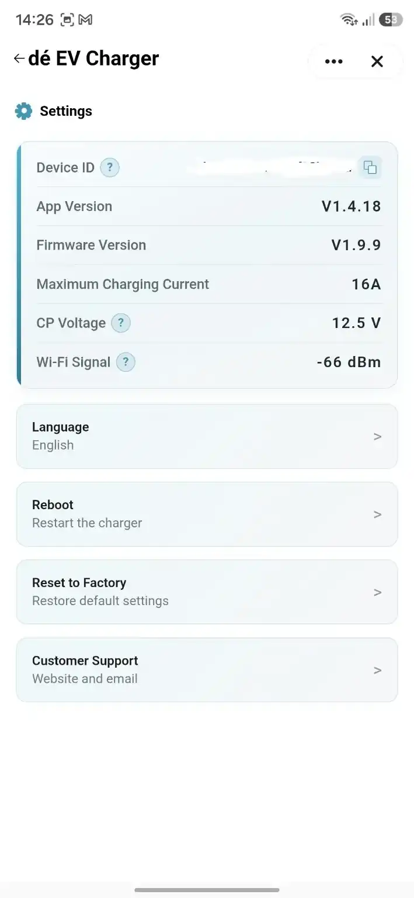

*Capture 03 - Informations du CRO dans Smart Life : version, courant maximal et informations réseau.*

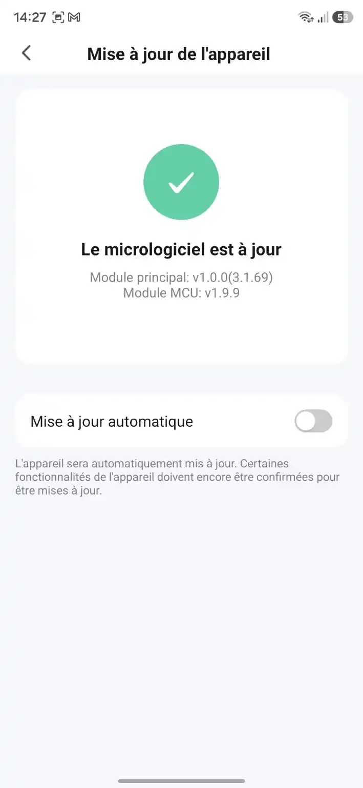

*Capture 04 - Vérification de la mise à jour du micrologiciel.*

> **Conseil :** évitez de réappairer inutilement le CRO une fois l'installation fonctionnelle. Un nouvel appairage peut modifier la `local_key`.

# 3. Facultatif : ce que donne l'intégration Tuya officielle

**Cette étape n'est pas nécessaire pour suivre le guide.** Dans l'installation testée, l'intégration Tuya officielle de Home Assistant voit bien le CRO, mais le classe comme appareil non pris en charge et ne crée aucune entité exploitable.


*Capture 05 - Le CRO apparaît dans Tuya officiel comme « unsupported » avec 0 entité.*

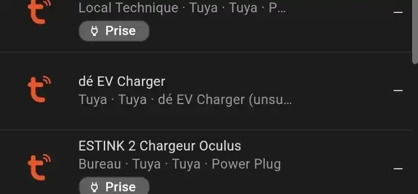

*Capture 06 - Le dé EV Charger est bien présent dans la liste des appareils Tuya de Home Assistant.*

> **Ce n'est pas bloquant :** la suite utilise Tuya EV Charger Local, qui dialogue directement avec le chargeur sur le réseau local.

# 4. Installer Tuya EV Charger Local avec HACS

Sur une **installation neuve**, ajoutez d'abord le dépôt de Valentin comme dépôt personnalisé HACS :

1. Ouvrez **HACS → Intégrations**.
2. Ouvrez le menu en haut à droite puis **Dépôts personnalisés / Custom repositories**.
3. Ajoutez :

```text
https://github.com/lachand/EV_charger
```

4. Choisissez la catégorie **Integration**.
5. Recherchez ensuite **Tuya EV Charger Local** dans HACS et installez-la.
6. Redémarrez Home Assistant si HACS le demande.

> Si **Tuya EV Charger Local** apparaît déjà dans votre HACS, ne rajoutez rien : le dépôt est déjà connu de votre installation. Installez simplement l'intégration.

# 5. Méthode recommandée : récupérer la local_key avec Tuya Local Key

Cette méthode est la plus simple pour une nouvelle installation.

Projet utilisé :

https://github.com/vineetchoudhary/tuya-local-key

Sa documentation indique explicitement qu'il ne nécessite **ni compte Tuya Developer, ni Cloud Project, ni Access ID, ni Access Secret**.

## 5.1 Installer Tuya Local Key dans Home Assistant

Pour Home Assistant OS :

1. Ouvrez **Paramètres → Applications → App Store**.
2. Ouvrez le menu en haut à droite.
3. Choisissez **Dépôts / Repositories**.
4. Ajoutez :

```text
https://github.com/vineetchoudhary/tuya-local-key
```

5. Installez **Tuya Local Key** depuis l'App Store.
6. Ouvrez l'application depuis Home Assistant.


*Capture 22 - Instructions d'installation de Tuya Local Key dans Home Assistant.*

L'application utilise Home Assistant Ingress par défaut. Il n'est pas nécessaire d'exposer son port directement sur Internet.

## 5.2 Se connecter au compte Smart Life ou Tuya Smart

Le flux de connexion utilise un QR code.

Avec **Smart Life** :

1. relevez le **User Code / Code utilisateur** dans **Me → Settings → Account and Security → User Code**
2. saisissez ce code dans Tuya Local Key
3. l'outil affiche un QR code
4. scannez-le avec Smart Life
5. confirmez la connexion dans l'application

Le schéma QR par défaut de Tuya Local Key est `smartlife`.

Si vous utilisez **Tuya Smart**, ouvrez la configuration de l'application Tuya Local Key et choisissez le schéma QR `tuyaSmart` si nécessaire.

Après connexion, la liste des appareils du compte apparaît. **Tuya Local Key récupère directement le Device ID et la `local_key` du chargeur.**

## 5.3 Copier la local_key du CRO

Dans la liste des appareils :

1. repérez **dé EV Charger**
2. vérifiez qu'il est indiqué **online**
3. repérez son **Device ID**
4. copiez sa **Local Key**

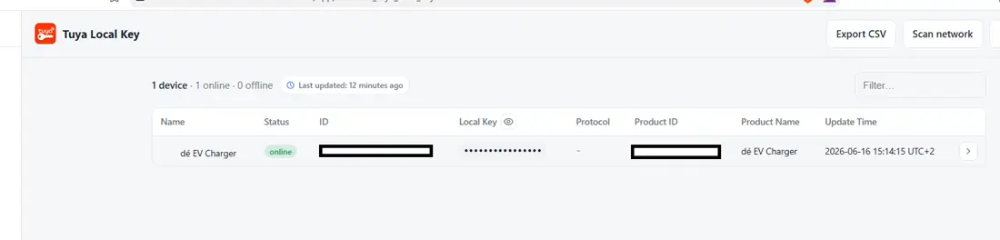

*Capture 23 - Le CRO apparaît dans Tuya Local Key avec son état, son Device ID, sa Local Key et son Product ID. Les identifiants sensibles sont masqués.*

Le Device ID est utile pour vérifier que vous sélectionnez ensuite le bon appareil, mais vous n'avez pas besoin de le recopier manuellement si le scan de Tuya EV Charger Local fonctionne.

> **Secret :** ne publiez jamais votre `local_key`. Tuya Local Key peut mettre en cache la liste des appareils dans Home Assistant ; traitez donc également les sauvegardes de cette application comme des données sensibles.

# 6. Ajouter le CRO dans Tuya EV Charger Local

Dans **Paramètres → Appareils et services → Ajouter une intégration**, recherchez **Tuya EV Charger Local**.

Choisissez **Scan network**.

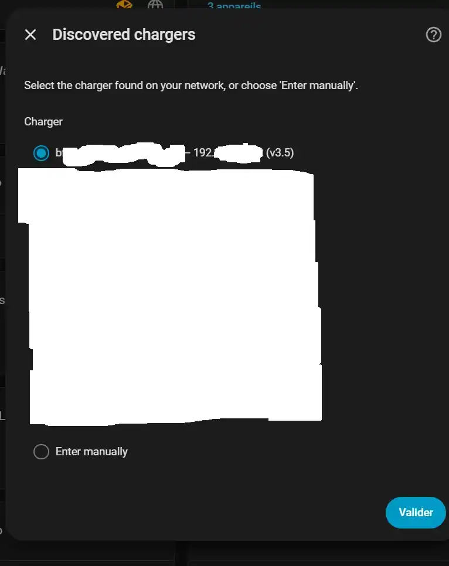

*Capture 08 - Le scan réseau découvre les appareils Tuya présents sur le réseau local.*

Le scan de Tuya EV Charger Local écoute les annonces Tuya et préremplit :

- l'adresse IP locale
- le Device ID
- la version de protocole Tuya

> **Réseau :** ce scan nécessite que Home Assistant soit sur le **même sous-réseau** que le CRO. Les broadcasts UDP Tuya ne traversent pas les VLAN ni la plupart des répéteurs Wi-Fi fonctionnant en NAT.

Sélectionnez le CRO correspondant au Device ID relevé dans Tuya Local Key.

Dans **Charger credentials** :

1. vérifiez l'IP et le Device ID
2. collez la `local_key`
3. sur le modèle testé, utilisez :
   - **Protocol version : 3.5**
   - **Charger profile / DP mapping : depow_v2**
4. validez


*Capture 09 - Écran « Charger credentials ». Sur cette capture, la local_key n'était pas encore renseignée ; IP et Device ID sont masqués.*


*Capture 19 - Paramètres validés sur le modèle testé : protocole 3.5 et profil depow_v2.*

```text
Protocol version: 3.5
Charger profile / DP mapping: depow_v2
```

### Si le scan réseau ne trouve pas le CRO

Vous pouvez choisir **Enter everything manually** dans Tuya EV Charger Local si vous connaissez déjà l'IP, le Device ID, la `local_key` et le protocole.

Tuya Local Key possède aussi son propre bouton **Scan network** : il peut rechercher l'IP locale et la version de protocole sur un sous-réseau indiqué manuellement, y compris à travers un VLAN si le pare-feu autorise TCP 6668 depuis Home Assistant.

# 7. Vérifier l'intégration dans Home Assistant

Une fois l'intégration validée, Home Assistant crée l'appareil et expose les contrôles, capteurs et options disponibles.

Sans véhicule, une partie des mesures reste naturellement à zéro ou inconnue.

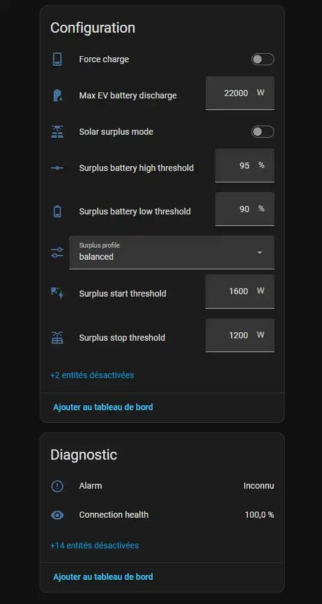

*Capture 20 - Exemple des sections Configuration et Diagnostic après intégration.*

Entités importantes :

- **Current setpoint** : consigne de courant
- **Voltage / Current / Power L1** : mesures électriques
- **Temperature** : température remontée par le CRO
- **Status** : état du chargeur
- **Connection health** : santé de la communication locale
- **Session energy** : énergie de la session
- **Solar surplus mode** : laissé désactivé dans ce premier tutoriel

# 8. Premier test sans véhicule : 6 A → 7 A

Le réglage de courant peut être testé sans véhicule.

Sur l'exemplaire utilisé pour ce guide, les valeurs **6, 7, 8, 9 et 12 A** ont été écrites puis relues correctement.

Cela confirme que le CRO accepte des pas de 1 A, même si Smart Life présente seulement quelques valeurs prédéfinies.

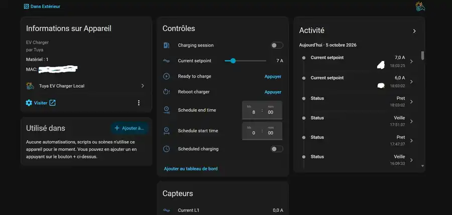

*Capture 21 - Historique Home Assistant montrant le passage de 6 A à 7 A et la nouvelle consigne relue.*

> **Résultat du test :** la commande provoque un bip immédiat du CRO, puis Home Assistant relit la nouvelle consigne quelques secondes plus tard.

# 9. Test de coupure secteur

Un test complémentaire a été réalisé avec une consigne laissée à **8 A** :

1. débrancher le CRO environ 30 secondes
2. le rebrancher
3. attendre sa reconnexion

Après redémarrage, la consigne **8 A** était toujours présente.

> **Conséquence :** la persistance de la consigne est pratique, mais elle devra être prise en compte plus tard dans toute logique de délestage ou de fail-safe.

Après une coupure, le statut peut également rester temporairement `unknown` avant de redevenir cohérent.

# 10. Méthode avancée alternative : récupération via Tuya Cloud

La méthode Cloud reste disponible si vous préférez que **Tuya EV Charger Local** récupère directement le Device ID et la `local_key`.

Elle est plus longue à configurer, mais présente un avantage : les identifiants Cloud permettent à l'intégration de récupérer automatiquement une nouvelle `local_key` après un réappairage du CRO.

> **À savoir :** le README actuel de l'intégration indique que les projets d'essai Tuya IoT expirent après environ **1 mois** et peuvent être prolongés jusqu'à environ **6 mois**. Après expiration, la récupération Cloud cesse de fonctionner, mais le pilotage local du CRO continue.

## 10.1 Choisir Fetch credentials from Tuya Cloud

Dans l'ajout de Tuya EV Charger Local, choisissez **Fetch credentials from Tuya Cloud**.

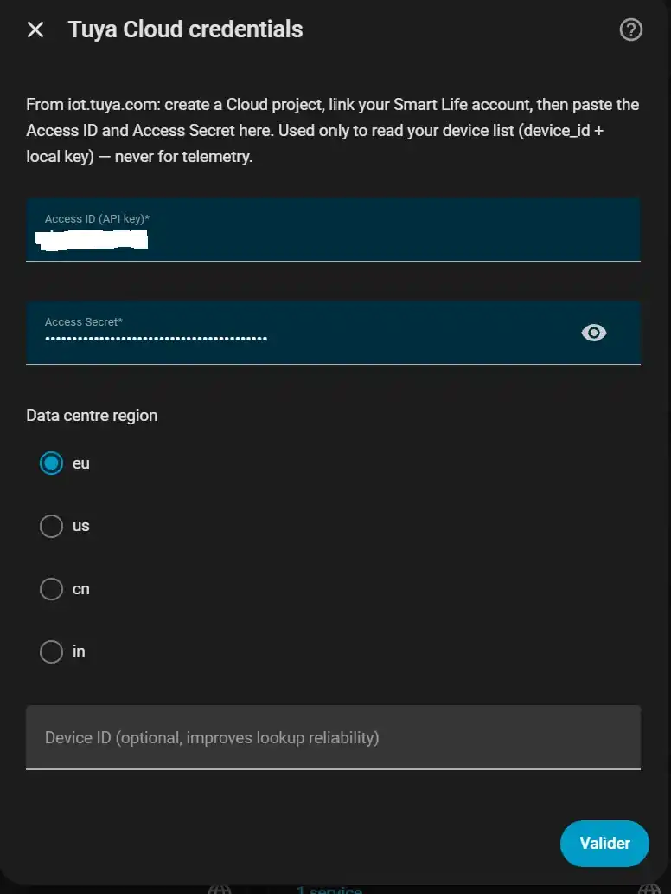

*Capture 10 - Écran Tuya Cloud credentials. L'Access Secret ne doit jamais être publié.*

## 10.2 Créer un compte Tuya Developer

1. Rendez-vous sur https://iot.tuya.com
2. créez ou activez un compte développeur
3. vérifiez que votre compte est enregistré comme **Individual Developer**


*Capture 11 - Compte Tuya enregistré comme Individual Developer.*


*Capture 12 - Accueil de la Tuya Developer Platform.*

## 10.3 Créer le Cloud Project

1. ouvrez **Cloud → Project Management**
2. créez un projet, par exemple **Home Assistant EV Charger**
3. choisissez **Smart Home**
4. sélectionnez le Data Center correspondant à votre compte

Pour l'installation européenne testée : **Central Europe Data Center**.

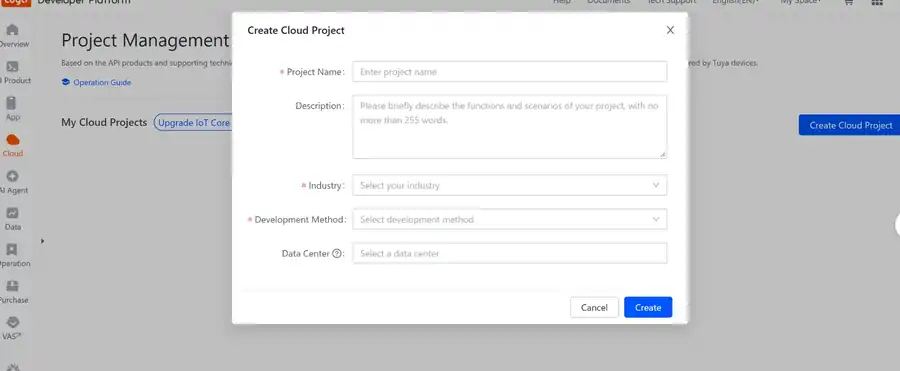

*Capture 13 - Création du Cloud Project.*

### Autoriser les API

Lors de l'assistant, autorisez les services nécessaires à l'accès Smart Home.

Dans la configuration testée, on retrouve notamment :

- IoT Core
- Authorization Token Management
- Smart Home Basic Service


*Capture 14 - Assistant d'autorisation des services API.*

### Récupérer Access ID et Access Secret

Dans **Overview**, relevez :

- Access ID / Client ID
- Access Secret / Client Secret

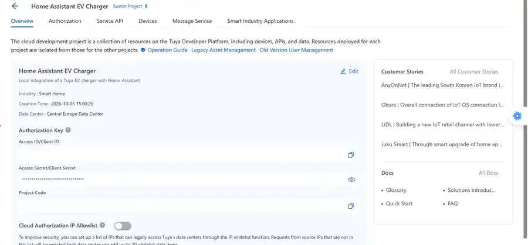

*Capture 15 - Les identifiants sensibles sont masqués dans la version publique.*

## 10.4 Relier le compte de l'application Tuya au projet

Dans **Devices → Link Tuya App Account**, associez le compte de l'application dans laquelle le CRO est réellement appairé.


*Capture 16 - Fenêtre de liaison du compte.*

Vous pouvez utiliser **Custom Link** pour n'associer que le CRO.


*Capture 17 - Un seul appareil associé au projet.*

## 10.5 Retour dans Home Assistant

Dans **Tuya EV Charger Local** :

1. choisissez **Fetch credentials from Tuya Cloud**
2. saisissez Access ID et Access Secret
3. choisissez la région correspondante
4. sélectionnez le dé EV Charger

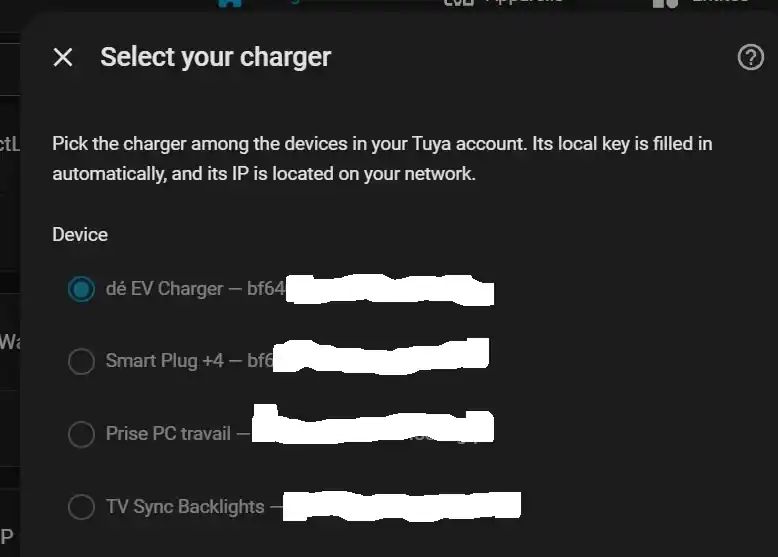

*Capture 18 - Sélection du CRO parmi les appareils retournés par Tuya Cloud.*

L'intégration remplit alors automatiquement la `local_key` et retrouve le chargeur sur le LAN.

## 10.6 Si Home Assistant indique « aucun appareil dans ce projet Tuya IoT »

Avant de recréer le projet ou de réappairer le CRO, vérifiez les points suivants :

| Vérification | Résultat attendu |
|---|---|
| Application utilisée | le compte lié correspond à l'application où le CRO est réellement appairé : Smart Life ou Tuya Smart |
| Data Center | le Cloud Project utilise le Data Center correspondant au compte |
| App Account | le compte de l'application est bien lié au Cloud Project |
| Manage Devices | le dé EV Charger apparaît réellement dans la liste |
| Device Status | `Online` |
| Associated devices | le CRO est compté parmi les appareils associés, par exemple `1/1` si seul le chargeur est lié |
| API Services | les services nécessaires au projet Smart Home sont autorisés |
| Credentials | Access ID et Access Secret proviennent bien de ce même Cloud Project |

Dans la configuration testée, les services proposés comprenaient notamment **IoT Core**, **Authorization Token Management** et **Smart Home Basic Service**.

> **Important :** un compte d'application « lié » ne garantit pas à lui seul que le CRO est réellement associé au projet. Vérifiez toujours **Manage Devices** avant de chercher plus loin.

Si cette méthode reste bloquée, la méthode **Tuya Local Key** décrite plus haut permet de récupérer directement le Device ID et la `local_key` sans dépendre du Cloud Project.

# 11. Conseils réseau et dépannage

- Utilisez un Wi-Fi 2,4 GHz stable au niveau du CRO.
- Home Assistant doit pouvoir joindre le chargeur sur le réseau local.
- Une réservation DHCP de l'adresse IP est recommandée.
- Si le CRO est réappairé, la `local_key` peut changer.
- Tuya Local Key permet de relire la clé si elle a tourné.
- Laissez le planning interne désactivé tant que vous n'en avez pas besoin.
- N'activez pas le mode « no-grounding » pour contourner un problème de terre.
- Ne publiez jamais Access Secret, `local_key` ou identifiants de compte.
- Un chargeur Tuya n'accepte qu'une seule connexion locale à la fois : Smart Life/Tuya Smart ou une autre intégration locale peut provoquer des refus de connexion intermittents.

# 12. Et après ?

Cette installation constitue la base.

Le projet peut ensuite évoluer vers :

- suivi des sessions et de l'énergie
- notifications Home Assistant
- mesure triphasée avec Shelly Pro 3EM
- délestage de la phase du CRO
- fail-safe en cas de perte des mesures
- détection du surplus photovoltaïque
- régulation dynamique de la charge
- comparaison température interne du CRO / température externe du coffret

> **Important :** ces fonctions avancées ne sont volontairement pas configurées dans ce guide. Elles feront l'objet d'un tutoriel séparé afin de garder cette procédure simple et reproductible.

# 13. Remerciements

Merci à **Valentin Lachand** pour le développement et le suivi de **Tuya EV Charger Local**.

Dépôt :
https://github.com/lachand/EV_charger

Merci également au développeur de **Tuya Local Key** pour l'outil de récupération simplifiée de la `local_key`.

Dépôt :
https://github.com/vineetchoudhary/tuya-local-key

Ce guide est basé sur une installation réellement testée et sur un second test d'intégration réalisé par un utilisateur de la communauté. Les interfaces Tuya, Smart Life, HACS et Home Assistant pouvant évoluer, les libellés exacts peuvent légèrement changer avec le temps.

# Annexe - Captures actuellement utilisées

| **N°** | **Capture** | **Étape** |
|---|---|---|
| 01 | Smart Life - écran principal | Étape 2 |
| 02 | Étiquette signalétique | Couverture / étape 1 |
| 03 | Smart Life - informations CRO | Étape 2 |
| 04 | Smart Life - mise à jour | Étape 2 |
| 05 | Tuya officiel - sans entités | Étape 3 |
| 06 | Tuya officiel - liste appareils | Étape 3 |
| 08 | HA - détection réseau | Étape 6 |
| 09 | HA - local_key manquante | Étape 6 |
| 10 à 18 | Méthode Tuya Cloud | Étape 10 |
| 19 | HA - protocole 3.5 / depow_v2 | Étape 6 |
| 20 | HA - configuration / diagnostic | Étape 7 |
| 21 | HA - test 6 A → 7 A | Étape 8 |
| 22 | Tuya Local Key - installation | Étape 5.1 |
| 23 | Tuya Local Key - CRO / Device ID / local_key | Étape 5.3 |

