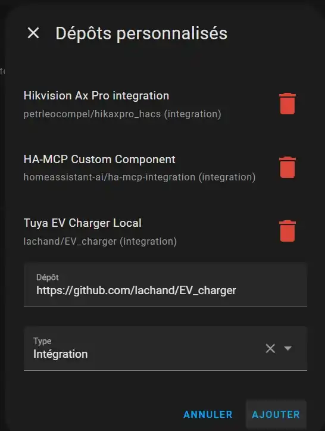

# 🇫🇷 Guide FR - Intégrer un dé EV Charger dans Home Assistant en local

**Tuya EV Charger Local + Smart Life + Tuya Cloud**

*Capture 02 - Étiquette du modèle réellement testé : deM2D03B7AB.*

Version illustrée V3 - octobre 2026

| **Périmètre :** ce guide couvre l’appairage, la récupération de la local_key et l’intégration locale du CRO. Le Shelly Pro 3EM, le délestage dynamique et la recharge solaire feront l’objet d’un second guide. |
|-----------------------------------------------------------------------------------------------------------------------------------------------------------------------------------------------------------------|

# 1. Configuration testée et principe

- dé Portable EV Charger 3,7 kW / 16 A, modèle deM2D03B7AB
- Wi-Fi 2,4 GHz
- Home Assistant avec HACS
- Smart Life pour l’appairage initial
- protocole Tuya 3.5
- profil depow_v2 dans Tuya EV Charger Local

| **Sécurité :** l’étiquette du CRO prévoit un mode “no-grounding”. Ne l’activez pas pour contourner une absence ou un défaut de terre. La recharge d’un véhicule doit rester sur une installation électrique conforme et correctement protégée. |
|------------------------------------------------------------------------------------------------------------------------------------------------------------------------------------------------------------------------------------------------|

<table>
<colgroup>
<col style="width: 100%" />
</colgroup>
<thead>
<tr class="header">
<th>CRO dé 
↓ Smart Life (appairage Wi-Fi) 
Tuya Cloud (récupération des identifiants) 
↓ 
Tuya EV Charger Local 
↓ 
Home Assistant → pilotage local LAN</th>
</tr>
</thead>
<tbody>
</tbody>
</table>

| **À retenir :** dans la configuration testée, le pilotage quotidien est local. Les identifiants Tuya Cloud servent à obtenir la local_key et à retrouver les informations du chargeur. |
|----------------------------------------------------------------------------------------------------------------------------------------------------------------------------------------|

# 2. Appairer le CRO dans Smart Life

1. Branchez le CRO sur le secteur, sans véhicule si vous souhaitez seulement effectuer la configuration.
2. Maintenez le bouton A environ 5 secondes jusqu’au clignotement de l’icône Wi-Fi.
3. Dans Smart Life, ajoutez l’appareil et connectez-le au réseau Wi-Fi 2,4 GHz.
4. Une fois l’appairage terminé, vérifiez les informations de l’appareil et les mises à jour disponibles.

*Capture 01 - Écran principal du dé EV Charger dans Smart Life.*

*Capture 03 - Informations du CRO dans Smart Life : version, courant maximal et informations réseau.*

*Capture 04 - Vérification de la mise à jour du micrologiciel.*

| **Conseil :** évitez de réappairer inutilement le CRO une fois l’installation fonctionnelle. Un nouvel appairage peut modifier la local_key. |
|----------------------------------------------------------------------------------------------------------------------------------------------|

# 3. Ce que donne l’intégration Tuya officielle

Dans l’installation testée, l’intégration Tuya officielle de Home Assistant voit bien le CRO, mais le classe comme appareil non pris en charge et ne crée aucune entité exploitable.

*Capture 05 - Le CRO apparaît dans Tuya officiel comme “unsupported” avec 0 entité.*

*Capture 06 - Le dé EV Charger est bien présent dans la liste des appareils Tuya de Home Assistant (capture recadrée pour préserver les autres appareils).*

| **Ce n’est pas bloquant :** la suite du tutoriel utilise Tuya EV Charger Local, qui dialogue directement avec le chargeur sur le réseau local. |
|------------------------------------------------------------------------------------------------------------------------------------------------|

# 4. Installer Tuya EV Charger Local avec HACS

5. Ouvrez HACS dans Home Assistant.
6. Dans **HACS → Intégrations**, recherchez **Tuya EV Charger Local** dans la barre de recherche.
7. Ouvrez l’intégration lorsqu’elle apparaît dans le store HACS, puis installez-la directement.
8. Redémarrez Home Assistant si HACS le demande.

> **Remarque :** l’ajout manuel du dépôt GitHub comme dépôt personnalisé n’est plus nécessaire lorsque **Tuya EV Charger Local** est disponible directement dans le store HACS.

*Capture 07 - Ancienne méthode par dépôt personnalisé, conservée ici comme référence visuelle. Si l’intégration est disponible directement dans HACS, utilisez simplement la recherche du store.*

# 5. Première détection locale du chargeur

Dans Paramètres → Appareils et services → Ajouter une intégration, recherchez “Tuya EV Charger Local”. La détection réseau permet de retrouver le CRO sur le LAN.

*Capture 08 - Le scan réseau découvre le chargeur et son adresse locale.*

À ce stade, le scan peut connaître l’IP, le Device ID et le protocole, mais il manque encore la local_key si vous ne l’avez pas récupérée autrement.

*Capture 09 - Écran “Charger credentials” : la local_key manque encore. IP et Device ID ont été masqués dans cette version publique.*

# 6. Choisir la récupération via Tuya Cloud

Revenez à l’ajout de l’intégration et choisissez la méthode qui récupère les identifiants via Tuya Cloud. Elle nécessite un Access ID et un Access Secret issus d’un Cloud Project Tuya.

*Capture 10 - Écran Tuya Cloud credentials dans Home Assistant. L’Access ID est masqué et l’Access Secret n’est jamais affiché en clair.*

# 7. Créer un compte Tuya Developer

9. Rendez-vous sur iot.tuya.com.
10. Créez ou activez un compte développeur. Le compte Developer Platform est distinct de l’usage quotidien de Smart Life.
11. Vérifiez que votre compte est bien enregistré comme “Individual Developer”, puis ouvrez la Developer Platform.

*Capture 11 - Compte Tuya enregistré comme Individual Developer.*

*Capture 12 - Accueil de la Tuya Developer Platform.*

# 8. Créer le Cloud Project

12. Dans la Developer Platform, ouvrez Cloud → Project Management.
13. Créez un nouveau Cloud Project, par exemple “Home Assistant EV Charger”.
14. Choisissez Smart Home comme industrie et méthode de développement.
15. Sélectionnez Central Europe comme Data Center pour cette installation européenne.

*Capture 13 - Création du Cloud Project “Home Assistant EV Charger”.*

## 8.1 Autoriser les API nécessaires

Lors de l’assistant de configuration, autorisez les services proposés pour l’accès Smart Home. Dans la configuration testée, on retrouve notamment IoT Core, Authorization Token Management et Smart Home Basic Service.

*Capture 14 - Assistant d’autorisation des services API du projet.*

## 8.2 Récupérer les identifiants du projet

Dans l’onglet Overview, relevez l’Access ID / Client ID et l’Access Secret / Client Secret. Conservez-les dans un endroit sûr.

*Capture 15 - Page Overview du projet. Les identifiants sensibles sont masqués dans la version publique.*

| **Secret :** ne publiez jamais l’Access Secret, la local_key ou vos identifiants de compte. Les captures destinées à GitHub doivent être anonymisées. |
|-------------------------------------------------------------------------------------------------------------------------------------------------------|

# 9. Relier le compte Smart Life au projet Tuya

Dans Devices → Link Tuya App Account, associez votre compte Smart Life. La plateforme peut proposer une liaison automatique de tous les appareils ou une liaison personnalisée.

*Capture 16 - Fenêtre de liaison du compte Smart Life. Pour ce tutoriel, choisissez “Custom Link” afin de n’associer que le CRO. La capture montre le dialogue avant la sélection finale.*

Après validation, sélectionnez uniquement le dé EV Charger. La ligne finale du compte doit indiquer “Custom Link”.

*Capture 17 - Compte Smart Life lié au projet avec la méthode Custom Link et un seul appareil associé.*

# 10. Retour dans Home Assistant : sélectionner le CRO

16. Dans Tuya EV Charger Local, choisissez “Fetch credentials from Tuya Cloud”.
17. Saisissez l’Access ID, l’Access Secret et la région eu.
18. Sélectionnez le dé EV Charger dans la liste retournée.

*Capture 18 - Sélection du dé EV Charger parmi les appareils associés au compte Tuya.*

L’intégration remplit alors automatiquement la local_key et retrouve l’adresse du CRO sur le réseau local.

*Capture 19 - Paramètres validés sur le modèle testé : protocole 3.5 et profil depow_v2. Les identifiants locaux ont été masqués.*

<table>
<colgroup>
<col style="width: 100%" />
</colgroup>
<thead>
<tr class="header">
<th>Protocol version: 3.5 
Charger profile / DP mapping: depow_v2</th>
</tr>
</thead>
<tbody>
</tbody>
</table>

# 11. Vérifier l’intégration dans Home Assistant

Une fois l’intégration validée, Home Assistant crée l’appareil et expose les contrôles, capteurs et options disponibles. Sans véhicule, une partie des mesures reste naturellement à zéro ou inconnue.

*Capture 20 - Exemple des sections Configuration et Diagnostic après intégration.*

- Current setpoint : consigne de courant
- Voltage / Current / Power L1 : mesures électriques lorsque disponibles
- Status : état du chargeur
- Connection health : santé de la communication locale
- Solar surplus mode : laissé désactivé dans ce premier tutoriel

# 12. Premier test sans véhicule : 6 A → 7 A

Le réglage de courant peut être testé sans véhicule. Sur l’exemplaire utilisé pour ce guide, les valeurs 6, 7, 8, 9 et 12 A ont été écrites puis relues correctement. Cela confirme que le CRO accepte des pas de 1 A, même si Smart Life présente seulement quelques valeurs prédéfinies.

*Capture 21 - Historique Home Assistant montrant le passage de 6 A à 7 A et la nouvelle consigne relue.*

| **Résultat du test :** la commande provoque un bip immédiat du CRO, puis Home Assistant relit la nouvelle consigne quelques secondes plus tard. |
|-------------------------------------------------------------------------------------------------------------------------------------------------|

# 13. Test de coupure secteur

Un test complémentaire a été réalisé avec une consigne laissée à 8 A : le CRO a été débranché environ 30 secondes puis rebranché. Après redémarrage, la consigne 8 A était toujours présente.

| **Conséquence :** la persistance de la consigne est pratique, mais elle devra être prise en compte plus tard dans toute logique de délestage ou de fail-safe. |
|---------------------------------------------------------------------------------------------------------------------------------------------------------------|

Après une coupure, le statut peut également rester temporairement “unknown” avant de redevenir cohérent. Une future logique de sécurité ne devra donc pas s’appuyer uniquement sur le statut du CRO.

# 14. Conseils réseau et dépannage

- Utilisez un Wi-Fi 2,4 GHz stable au niveau du CRO.
- Home Assistant doit pouvoir joindre le chargeur sur le réseau local.
- Une réservation DHCP de l’adresse IP est recommandée.
- Si le CRO est réappairé, la local_key peut changer.
- Laissez le planning interne désactivé tant que vous n’en avez pas besoin.
- N’activez pas le mode “no-grounding” pour contourner un problème de terre.

# 15. Et après ?

Cette installation constitue la base. Le projet peut ensuite évoluer vers :

- suivi des sessions et de l’énergie
- notifications Home Assistant
- mesure triphasée avec Shelly Pro 3EM
- délestage de la phase du CRO
- fail-safe en cas de perte des mesures
- détection du surplus photovoltaïque
- régulation dynamique de la charge

| **Important :** ces fonctions avancées ne sont volontairement pas configurées dans ce guide. Elles feront l’objet d’un tutoriel séparé afin de garder cette procédure simple et reproductible. |
|------------------------------------------------------------------------------------------------------------------------------------------------------------------------------------------------|

# 16. Remerciements

Merci à Valentin Lachand pour le développement et le suivi de Tuya EV Charger Local.

Dépôt GitHub : https://github.com/lachand/EV_charger

Ce guide est basé sur une installation réellement testée. Les interfaces Tuya, Smart Life, HACS et Home Assistant pouvant évoluer, les libellés exacts peuvent légèrement changer avec le temps.

# Annexe - Mapping des 21 captures

| **N°** | **Capture**                     | **Étape**            | **N°** | **Capture**                     | **Étape** |
|--------|---------------------------------|----------------------|--------|---------------------------------|-----------|
| 01     | Smart Life - écran principal    | Étape 2              | 12     | Tuya Developer Platform         | Étape 7   |
| 02     | Étiquette signalétique          | Couverture / étape 1 | 13     | Tuya - création Cloud Project   | Étape 8   |
| 03     | Smart Life - informations CRO   | Étape 2              | 14     | Tuya - autorisation API         | Étape 8.1 |
| 04     | Smart Life - mise à jour        | Étape 2              | 15     | Tuya - credentials projet       | Étape 8.2 |
| 05     | Tuya officiel - sans entités    | Étape 3              | 16     | Tuya - Link App Account         | Étape 9   |
| 06     | Tuya officiel - liste appareils | Étape 3              | 17     | Tuya - Link Device CRO          | Étape 9   |
| 07     | HACS - ajout dépôt              | Étape 4              | 18     | HA - sélection CRO compte Tuya  | Étape 10  |
| 08     | HA - détection réseau           | Étape 5              | 19     | HA - protocole 3.5 / depow_v2   | Étape 10  |
| 09     | HA - local_key manquante        | Étape 5              | 20     | HA - configuration / diagnostic | Étape 11  |
| 10     | HA - Tuya Cloud credentials     | Étape 6              | 21     | HA - test 6 A → 7 A             | Étape 12  |
| 11     | Tuya - Individual Developer     | Étape 7              |        |                                 |           |
